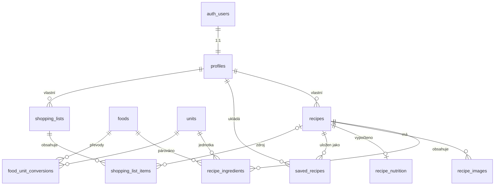

# Datový model

Migrace jsou v `supabase/migrations/`:

| Soubor | Obsah |
|---|---|
| `20261023120000_initial_schema.sql` | Rozšíření, tabulky, indexy, číselník jednotek |
| `20261023120100_functions.sql` | Přepočet gramů, nutriční výpočet, vyhledávání, nákupní seznam |
| `20261023120200_rls.sql` | Row Level Security |
| `20261023120300_storage.sql` | Buckety a politiky pro obrázky |

## Schéma

## Tabulky

| Tabulka | Účel |
|---|---|
| `profiles` | Profil uživatele (zobrazované jméno, avatar). Zakládá se triggerem při registraci. |
| `recipes` | Recept: název, popis, kroky (`steps text[]`), porce, časy, `visibility` (`private` / `public`), zdroj (`manual` / `photo` / `import`). |
| `recipe_ingredients` | Suroviny v pořadí: původní text (`raw_text`), název, množství, jednotka, gramy, vazba na `foods`, skupina („Na těsto“), volitelnost. |
| `recipe_images` | Obrázky receptu, `position = 0` je titulní. |
| `recipe_nutrition` | Nutriční hodnoty za celý recept a míra pokrytí (`matched_ingredients` / `total_ingredients`). Na porci = celkem / `recipes.servings`. |
| `saved_recipes` | Veřejné recepty jiných uživatelů přidané do „mé kuchařky“. Jde o odkaz, ne kopii. |
| `shopping_lists`, `shopping_list_items` | Nákupní seznamy a jejich položky. |
| `foods` | Nutriční databáze (hodnoty na 100 g), import z Nutridatabáze.cz nebo CIQUAL. |
| `units` | Číselník jednotek (g, dkg, kg, ml, dl, l, lžička, lžíce, hrnek, špetka, ks…). |
| `food_unit_conversions` | Hmotnost jednotky pro konkrétní potravinu (1 ks vejce = 55 g, 1 hrnek mouky = 140 g). |

## Automatické výpočty

**Gramy suroviny** (trigger `recipe_ingredients_resolve_grams`). Výpočet má toto pořadí:
1. převod pro konkrétní potravinu (`food_unit_conversions`),
2. hmotnostní jednotka (`units.grams_per_unit`),
3. objemová jednotka × hustota potraviny (výchozí hustota 1 g/ml),
4. jinak `null`.

Pokud uživatel gramy zadá ručně, nastaví `grams_is_manual = true` a trigger je nepřepisuje.

**Nutriční hodnoty** (trigger `recipe_ingredients_recalculate_nutrition`) se přepočítají při každé změně surovin. Volitelné suroviny se do součtu nezapočítávají. Do tabulky `recipe_nutrition` zapisuje jen funkce `recalculate_recipe_nutrition()`, klient ji volat nemůže.

## RPC funkce pro klienta

| Funkce | Popis |
|---|---|
| `search_recipes(p_query, p_scope, p_limit, p_offset)` | Fulltext bez diakritiky s prefixovým hledáním („knedlik“ najde „knedlíky“), hledá i v surovinách. `p_scope`: `cookbook` (vlastní + uložené), `mine`, `saved`, `public`. |
| `search_foods(p_query, p_limit)` | Kandidáti z `foods` pro párování suroviny, podle podobnosti trigramů. |
| `add_recipe_to_shopping_list(p_list_id, p_recipe_id, p_servings)` | Přidá suroviny receptu do seznamu a přepočítá je na zvolený počet porcí. Stejné nezaškrtnuté položky (stejná potravina nebo název a jednotka) sčítá. |

Volání z klienta: `supabase.rpc('search_recipes', { p_query: 'svíčková', p_scope: 'cookbook' })`.

## Oprávnění (RLS)

Anonymní přístup je zakázán, všechny politiky platí pro roli `authenticated`.

| Data | Čtení | Zápis |
|---|---|---|
| `profiles` | všichni přihlášení | vlastník |
| `recipes` | vlastník, nebo kdokoli u veřejného receptu | vlastník |
| `recipe_ingredients`, `recipe_images` | podle viditelnosti receptu | vlastník receptu |
| `recipe_nutrition` | podle viditelnosti receptu | pouze serverová funkce |
| `saved_recipes` | vlastník | vlastník, jen veřejné cizí recepty |
| `shopping_lists`, `shopping_list_items` | vlastník | vlastník |
| `foods`, `units`, `food_unit_conversions` | všichni přihlášení | jen `service_role` / migrace |

## Storage

| Bucket | Cesta | Pravidla |
|---|---|---|
| `recipe-images` (max. 5 MB) | `{owner_id}/{recipe_id}/{soubor}` | Čtení podle viditelnosti receptu, zápis jen vlastník receptu. |
| `recipe-imports` (max. 10 MB) | `{owner_id}/{soubor}` | Fotky pro rozpoznání textu, přístup jen vlastník. |

Buckety jsou soukromé. Klient zobrazuje obrázky přes podepsané URL (`createSignedUrl`).

## Známá omezení a další kroky

- **Smazání účtu:** smazání v `auth.users` kaskádově odstraní všechna data v DB. Soubory ve Storage je třeba smazat zvlášť v Edge Function, která bude mazání účtu obsluhovat.
- **Uložené recepty** zmizí z kuchařky, pokud je autor nastaví jako soukromé. Možné rozšíření je funkce „zkopírovat do mé kuchařky“.
- **Veřejné recepty** vidí jen přihlášení uživatelé. Veřejný webový náhled by potřeboval doplnit politiky pro roli `anon`.
- **Změna hodnot v `foods`** zatím nepřepočítá existující recepty. Po importu nutriční databáze je potřeba jednorázový přepočet.
- **Čeština ve fulltextu:** PostgreSQL nemá český slovník. Používá se konfigurace `simple` bez diakritiky s prefixovým hledáním, skloňování se tedy pokrývá jen částečně.
